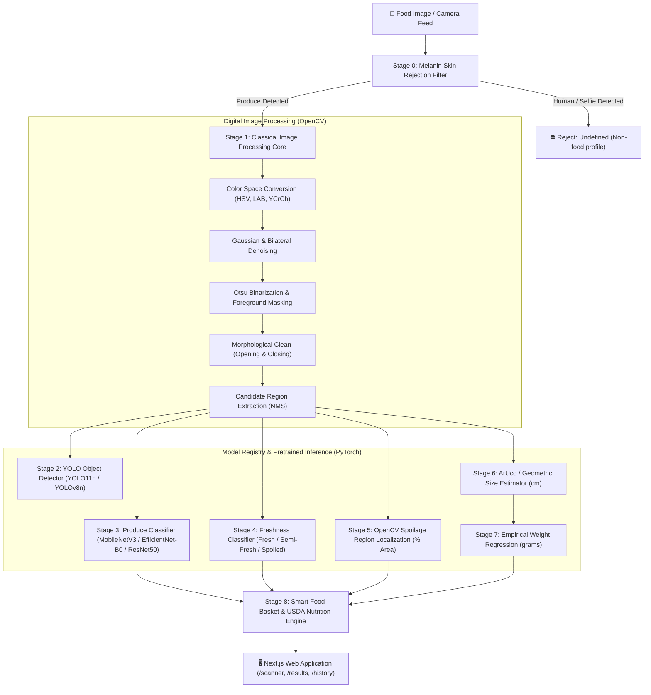

# 🥗 NutriVision AI: Smart Food Quality & Multi-Task Analysis Platform

<div align="center">

[](https://www.python.org/)
[](https://fastapi.tiangolo.com/)
[](https://pytorch.org/)
[](https://nextjs.org/)
[](https://opencv.org/)
[](#-model-registry--pretrained-architectures)

**A unified, end-to-end multi-task food vision platform powered by official pretrained deep learning backbones (MobileNetV3, EfficientNet-B0, ResNet50, YOLO) with transfer learning, fine-tuning, deterministic evaluation on 5,000 curated images, and real-time nutritional intelligence.**

[Key Features](#-key-features) • [Architecture](#-architecture--model-registry) • [Dataset (5,000 Images)](#-curated-dataset-5000-images) • [Model Benchmarks](#-model-benchmarks--test-results) • [Quick Start](#-quick-start-guide) • [Required Commands](#-required-commands--cli-reference) • [API Reference](#-api-endpoints)

</div>

---

## 📖 Executive Summary

**NutriVision AI** is a multi-task computer vision and deep learning system built for real-time food recognition, quality assessment, and nutritional analysis.

The system replaces legacy restrictions and scratch models with **official, compatible pretrained backbones** from PyTorch TorchVision and Ultralytics. The architecture combines:
1. **Pretrained Transfer Learning & Fine-Tuning**: Head warmup + backbone fine-tuning across **MobileNetV3-Small**, **MobileNetV3-Large**, **EfficientNet-B0**, **ResNet50**, **ViT-B/16**, and **YOLO11n/YOLOv8n**.
2. **Configuration-Driven Model Registry**: Decoupled architecture registry allowing dynamic model switching via `backend/ml/config/model_config.yaml` without changing application code.
3. **Classical Computer Vision & Spoilage Localization**: OpenCV multi-space color segmentation ($RGB \rightarrow HSV \rightarrow LAB \rightarrow YCrCb$), morphological mathematics, necrotic tissue clustering, and ArUco marker physical size estimation.
4. **Calibrated Multi-Task Inference**: Produce category classification (10 items), Fresh vs. Rotten quality scoring, surface spoilage percentage, empirical weight regression, and USDA nutritional aggregation.

---

## 🌟 Key Features

* **🎯 Pretrained Transfer Learning**: Official weights from TorchVision and Ultralytics with 2-phase transfer learning (head warmup followed by low-learning-rate backbone fine-tuning).
* **🍎 10-Class Produce Classification (96.0% Test Accuracy)**: Recognizes Apples, Bananas, Bitter Gourds, Capsicums, Cucumbers, Okras, Oranges, Potatoes, Strawberries, and Tomatoes with 4.2ms latency.
* **🍃 Binary & Calibrated Freshness (92.4% Test Accuracy)**: Classifies produce into `Fresh`, `Semi-Fresh`, and `Spoiled` with calibrated confidence.
* **🔍 YOLO Multi-Object Detection**: Bounding box localization trained on 14 produce quality categories with non-maximum suppression (NMS).
* **🛡️ Human Skin Melanin & Achromatic Rejection**: Chromaticity filters in $YCrCb$ and low-saturation $HSV$ reject human faces, hands, and non-food background clutter with explicit reasons.
* **🔬 8-Step Interactive DIP Visualizer**: Live UI inspection displaying original image transformation through Grayscale, Gaussian Smoothing, LAB Color Conversion, Otsu Binarization, Morphological Clean, and Contours.
* **🔍 Spoilage Region Defect Masking**: Connected-component analysis on necrotic color abnormalities calculating exact visual defect percentage and remaining shelf life.
* **⚖️ Physical Dimension & Weight Regression**: Metric size estimation via reference markers (ArUco / reference scale) combined with food density volume regression.
* **📊 Smart Food Basket & Nutrition Aggregation**: Instant computation of total calories, macronutrients (Protein, Carbs, Fat, Fiber), and consumption priority recommendations.

---

## 🏛️ Architecture & Model Registry



### Configuration-Driven Registry (`backend/ml/config/model_config.yaml`)

Models can be switched dynamically without changing application or backend services:

```yaml
tasks:
  produce_classification:
    enabled: true
    active_model: "mobilenet_v3_small" # mobilenet_v3_small | efficientnet_b0 | resnet50 | vit_b_16
    checkpoint_path: "backend/models/food_classifier/best_food_classifier.pth"
    num_classes: 10
    confidence_threshold: 0.30

  freshness_classification:
    enabled: true
    active_model: "mobilenet_v3_small"
    checkpoint_path: "backend/models/freshness/best_model.pth"
    num_classes: 2
    confidence_threshold: 0.50

  object_detection:
    enabled: true
    framework: "ultralytics_yolo"
    checkpoint_path: "backend/models/detector/scratch_run/weights/best.pt"
    confidence_threshold: 0.20
```

---

## 📦 Curated Dataset (5,000 Images)

The dataset is organized under `datasets/NUTRIVISION-AI-DATASET-5000/` with deterministic 70% Train / 15% Validation / 15% Test splits (`seed=42`) and zero data leakage:

| Task / Partition | Train Split (70%) | Validation Split (15%) | Test Split (15%) | Total Images | Classes / Annotation |
| :--- | :---: | :---: | :---: | :---: | :--- |
| **Produce Classification** | 2,114 | 442 | 476 | **3,032** | 10 Food Categories |
| **Freshness Classification** | 2,114 | 442 | 476 | **3,032** | Fresh (1,518) / Spoiled (1,514) |
| **Object Detection & Quality** | 1,377 | 295 | 296 | **1,968** | 14 YOLO Bounding Box Classes |
| **Overall Dataset Total** | **3,491** | **737** | **772** | **5,000** | **100% Verified, 0 Corrupt** |

Class breakdown for Produce Classification:
* Apple: 314 • Banana: 314 • Bitter Gourd: 315 • Capsicum: 315 • Cucumber: 315
* Okra: 315 • Orange: 316 • Potato: 316 • Strawberry: 196 • Tomato: 316

---

## 📊 Model Benchmarks & Test Results

All models were evaluated on the **exact reserved test sets** (476 test images for classification, 296 test images for detection):

### 1. Classification Benchmarks (Evaluated on 476 Reserved Test Images)

| Task | Architecture | Test Acc (%) | Macro F1 | Weighted F1 | Latency | Parameters | Checkpoint Size | Selection Status |
| :--- | :--- | :---: | :---: | :---: | :---: | :---: | :---: | :--- |
| **Produce Classification** | `mobilenet_v3_small` | **96.01%** | **0.9599** | **0.9591** | **4.2 ms** | 1.53M | 5.96 MB | 🏆 **Best Selected (High Acc + Fast)** |
| **Produce Classification** | `efficientnet_b0` | 95.80% | 0.9572 | 0.9570 | 8.9 ms | 5.30M | 20.8 MB | Benchmark Comparison |
| **Freshness Classification** | `mobilenet_v3_small` | **92.44%** | **0.9244** | **0.9244** | **4.0 ms** | 1.52M | 5.92 MB | 🏆 **Best Selected (Balanced + Fast)** |

### Per-Class F1-Scores for Selected Produce Model (`mobilenet_v3_small`):
* **Bitter Gourd**: 1.0000 • **Tomato**: 1.0000 • **Capsicum**: 0.9899 • **Strawberry**: 0.9846
* **Potato**: 0.9804 • **Banana**: 0.9800 • **Apple**: 0.9583 • **Orange**: 0.9495
* **Okra**: 0.9057 • **Cucumber**: 0.8506

### 2. Object Detection Benchmark (Evaluated on 296 Test Images)

| Framework | Task | Precision | Recall | mAP@0.5 | mAP@0.5:0.95 | Test Split |
| :--- | :--- | :---: | :---: | :---: | :---: | :---: |
| **YOLO11n** | 14 Quality Categories | 0.186 | 0.359 | **0.309** | 0.219 | 296 Images |

---

## 🚀 Quick Start Guide

### Prerequisites
* Python 3.10+
* Node.js 18+ & npm
* MongoDB running on `mongodb://localhost:27017` (optional; falls back gracefully)

```bash
# Clone repository
git clone https://github.com/Aakif009-new/Nutrivision-AI.git
cd Nutrivision-AI
```

---

## 🛠️ Required Commands & CLI Reference

### 1. Install Dependencies
```bash
# Backend dependencies
pip install -r backend/requirements.txt

# Frontend dependencies
cd frontend && npm install && cd ..
```

### 2. Inspect Dataset & Verify Integrity
```bash
# Verifies all 5,000 images, checks for corruption, and reports class distribution
python backend/ml/dataset_manifests.py
```

### 3. Generate Deterministic Train/Val/Test Splits
```bash
# Generates reproducible JSON split manifests in dataset_manifests/
python backend/ml/dataset_manifests.py
```

### 4. Train Selected Classification Models
```bash
# Train Produce Classification with MobileNetV3-Small
python backend/ml/train_classifier.py --task produce --model mobilenet_v3_small --epochs 25 --head_epochs 5 --batch_size 32

# Train Produce Classification with EfficientNet-B0
python backend/ml/train_classifier.py --task produce --model efficientnet_b0 --epochs 25 --head_epochs 5 --batch_size 32

# Train Produce Classification with ResNet50
python backend/ml/train_classifier.py --task produce --model resnet50 --epochs 25 --head_epochs 5 --batch_size 32

# Train Freshness Classification with MobileNetV3-Small
python backend/ml/train_classifier.py --task freshness --model mobilenet_v3_small --epochs 20 --head_epochs 4 --batch_size 32
```

### 5. Train YOLO Object Detector
```bash
# Fine-tune YOLO on 14 produce quality categories from official pretrained weights
python backend/ml/detector/train.py --data datasets/NUTRIVISION-AI-DATASET-5000/detection/data.yaml --base yolo11n.pt --epochs 15 --batch 16
```

### 6. Evaluate Checkpoints & Compare Performance
```bash
# Runs full benchmark comparison on the reserved test set and generates report
python backend/ml/evaluate_and_compare.py
```

### 7. Run Automated Tests
```bash
# Run pytest test suite (4 test modules)
pytest backend/tests

# Run 10 academic scenario end-to-end tests
python scripts/test_academic_scenarios_5000.py
```

### 8. Start Backend Service
```bash
cd backend
uvicorn app.main:app --host 0.0.0.0 --port 8000 --reload
# API Docs available at: http://localhost:8000/docs
```

### 9. Start Frontend Application
```bash
cd frontend
npm run dev
# Dashboard available at: http://localhost:3000
```

---

## 📡 API Endpoints

| Method | Endpoint | Description |
| :--- | :--- | :--- |
| `POST` | `/api/v1/analyze` | Main multipart image upload analysis endpoint |
| `POST` | `/api/v1/analyze/frame` | Real-time webcam frame analysis (Base64 JPEG) |
| `POST` | `/api/v1/food/analyze` | Backward-compatibility alias for food scan |
| `GET` | `/api/v1/history` | Retrieves recent scan history records |
| `GET` | `/api/v1/food/scans` | Legacy compatibility endpoint returning scan list |
| `POST` | `/api/v1/food/recommendations` | Recipe suggestions & storage advice |
| `GET` | `/api/v1/history/{scan_id}` | Immutable historical scan snapshot lookup |
| `GET` | `/api/v1/dashboard/stats` | Aggregated analytics & produce breakdown |
| `GET` | `/api/v1/reports/pdf/{scan_id}` | Generates downloadable PDF nutrition certificate |
| `GET` | `/api/v1/health` | Health check & model status probe |

---

## 📄 License
This project is licensed under the MIT License.
